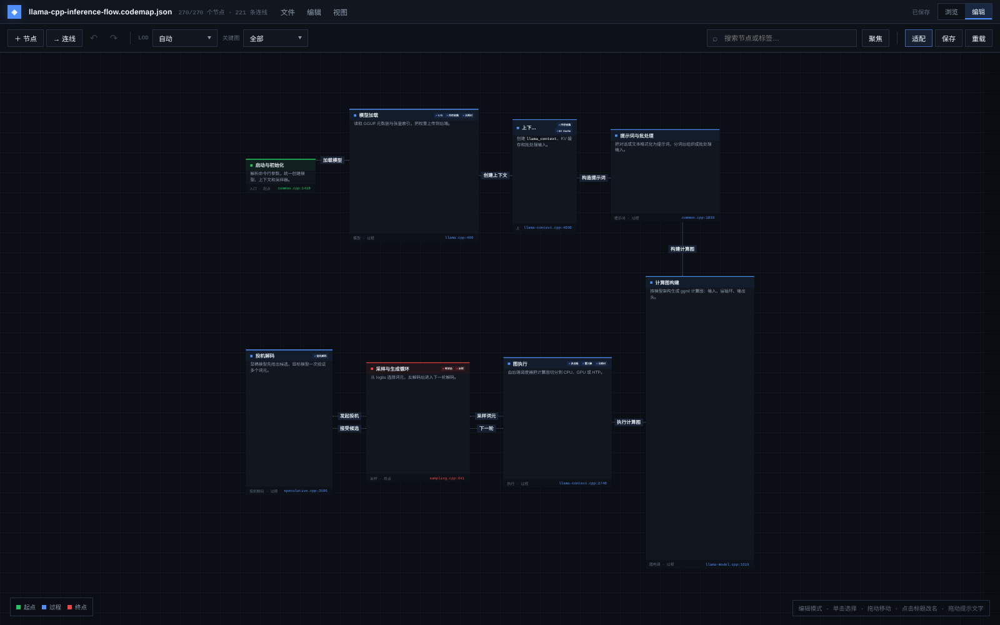
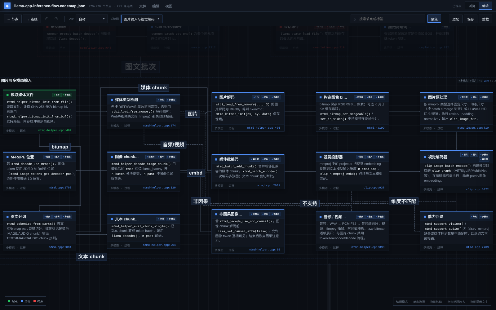
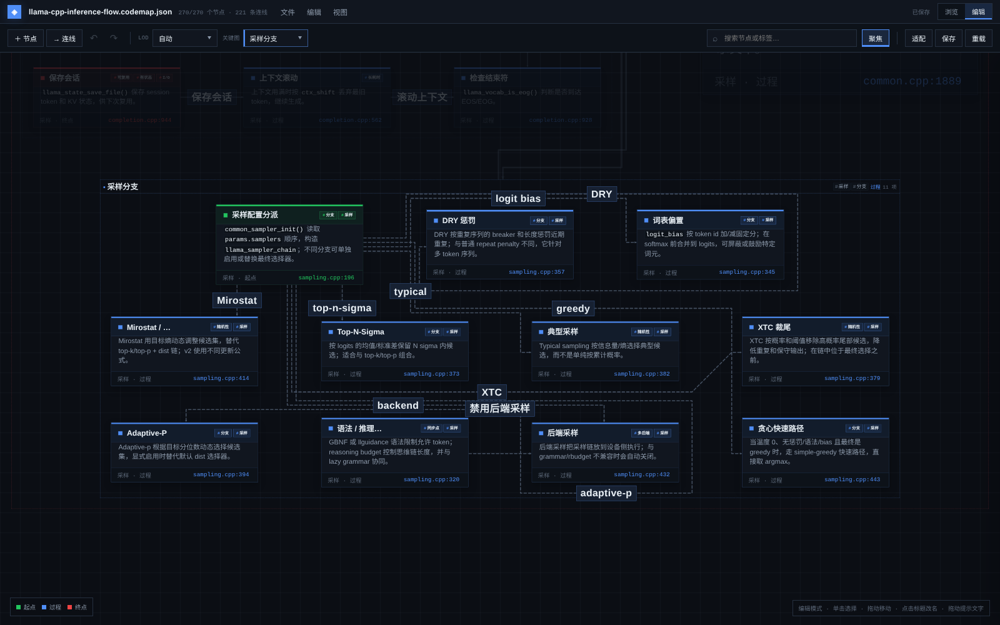
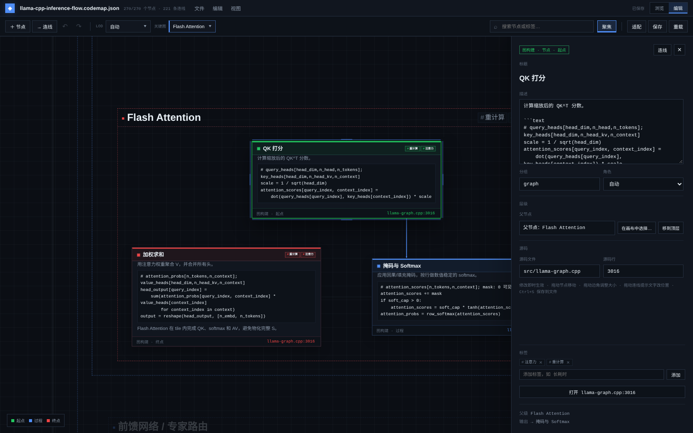
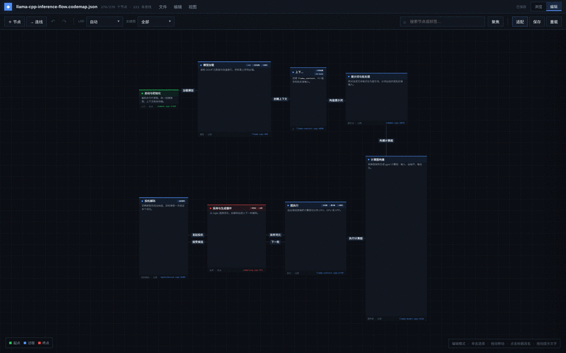

# Code Node Map

作者：wangyifu

一个面向源码的通用节点图查看器。节点支持 Markdown、源码跳转和任意有向边；
节点还可以成为可嵌套的容器。所有节点和容器的位置、尺寸都由地图文件明确
指定，查看器不做自动布局，也不会改变文件中的坐标。

这个扩展不依赖具体仓库。只要提供一个符合下面格式的 JSON，就可以查看任意
代码结构图。

## 界面预览

**总览：阶段、容器与连线**



**图片与多模态输入**



**网状分支：采样器可选路径**



**编辑模式：节点属性、标签与源码定位**



**LOD 缩放：从阶段总览到模块细节**



## 功能

- 任意有向图，允许环和多条边
- Markdown 节点内容
- 节点右下角源码位置跳转
- 8 方向折线连线：水平、垂直、45 度
- 直连优先：两个节点在水平或垂直方向有投影重叠时，直接在共享边上选择端口，不强制走边缘中点
- 连线拐角不小于 90 度，不使用锐角
- 节点不重叠，连线不穿过节点或容器边框，不允许共线重合
- 路由会尝试多种连边顺序，尽量减少交叉和不必要的弯折
- 路由为节点和容器边框保留软净空：长距离平行段不会贴近边框，直连车道会优先选择净空更大的通道
- 拖动节点时连线实时重新路由，不会消失
- 拖动时只重排受影响的连线，其余连线保持稳定
- 拖动节点时自动阻止与其它节点、容器框重叠
- 碰到阻挡时沿可用方向滑动，而不是完全卡住
- 关键图聚焦：按子图突出显示一条链路，补集可调透明度
- 容器节点：可包含其他节点，可多层嵌套；容器始终展开，不能收起
- 显式布局：每个节点的 `x`、`y`、`width`、`height` 都是必填项
- 连线可选指定起点/终点锚点和多个途径点；不指定时自动选择端口
- 深度分级 LOD：每个嵌套深度有独立缩放阈值，层级越深出现得越晚，相邻层级之间保留较长的稳定区间
- 叶子节点不参与 LOD：一旦可见就显示完整卡片
- 容器 LOD 卡片复用容器框矩形，并与叶子节点共用同一套卡片 DOM 和 CSS 布局；只通过整体缩放适配不同层级，宽高比可任意变化
- 连线提示文字不参与 LOD；按连线所在层级使用由粗到细的世界坐标字号，并绘制在节点上层且避开所有节点
- 粗层级连线使用更粗线宽；连线文字带矩形底衬，标签与正文互不混在一起
- 三色角色着色：只为逻辑起点、过程、终点着色；角色可由连线自动推断，也可用 `role` 覆盖
- 标签系统：节点可显示任意标签，详情面板可添加/移除，修改后进入未保存状态
- 内联节点编辑器：选中节点即可直接修改标题、描述、分组、角色、源码位置和父节点，输入即时生效；点击标题或描述即可开始编辑，`Ctrl+S` 保存回地图文件
- 菜单栏 + 工具栏：文件/编辑/视图菜单，新增/连线/撤销/重做、LOD、关键图、搜索、聚焦、适配、保存和重载集中在顶部两栏
- LOD 档位：`自动` 跟随缩放；`L0 总览` 到 `L4 叶子` 可固定显示层级，不随缩放变化
- 多模态输入：图片/音频/视频 → bitmap → mmproj 视觉/音频编码器 → 投影 → 图文 chunk 交错解码；包含 M-RoPE、非因果图像注意力和能力回退分支
- 网状分支：Dense/MoE/循环架构、注意力与 RoPE 变体、KV 缓存变体、采样器分支、投机草稿来源、后端卸载/回退等都以独立分支节点和虚线连接表达
- 浏览/编辑双模式：浏览模式只保留相机与查看操作，编辑模式开放全部编辑能力
- 连线提示文字可直接拖动改变位置，偏移会随地图保存；属性面板可一键重置
- 节点与容器统一：不需要单独“新增容器”，任何节点添加子节点后自动成为容器
- 节点大小通过拖动选择框的边或角调整，不需要输入坐标或宽高数字
- 打开的 Webview 是编辑器，面板标题和页面标题使用地图文件名；VS Code 窗口重载后会恢复地图面板和未保存编辑
- 连线统一加粗并保持中性色，使用非缩放描边减少不同方向、不同缩放下视觉粗细差异
- 自定义下拉菜单、标签建议列表和右键菜单，不依赖系统原生控件
- 不使用渐变；容器内部保持透明，只保留边框和标题
- 搜索、适配、拖拽、缩放/平移
- VS Code 明暗主题支持

## 操作

- 点击节点：选中，并在右侧直接打开可编辑属性面板
- 点击节点标题：就地改名；点击描述正文：直接进入描述编辑
- 点击节点右下角的 `file:line`：打开源码
- 双击画布空白处：在当前位置新增节点并打开编辑器
- 在右侧属性面板的“标签”区域输入标签并回车即可添加；标签修改进入未保存状态，`Ctrl+S` 保存
- 选中节点或容器后拖动选择框的边或角：调整大小；拖动节点/容器移动位置
- 拖拽节点时，鼠标下的容器会高亮；松开后节点归入该容器，拖到空白处则移到顶层
- 在画布空白处右键：新增节点或连线；画布新增的节点始终是顶层节点
- 右键任意节点：编辑、复制、剪切、删除、新增子节点、从此节点新增连线；添加子节点后该节点自动成为容器
- 拖动节点到某个容器内即可自动归入该容器；拖到容器外的空白处则移到顶层
- 右键节点选择“选择父节点…”后，直接点击目标节点即可重新指定父级，不需要从长下拉列表中查找
- 节点编辑器中的“父节点”一行显示当前父级，可点“在画布中选择…”或“移到顶层”
- 点击属性面板右上角“连线”、画布右键 `新增连线` 或节点菜单里的“从此节点新增连线”：顶部出现连线模式提示，依次点击起点和终点节点即可；点击取消或按 `Esc` 退出
- 点击连线或连线提示文字：在右侧属性面板编辑连线，不再弹出对话框
- 拖动连线提示文字：调整其在画布上的位置；属性面板中的“重置文字位置”恢复自动放置
- 拖动连线起点/终点方形手柄：自动吸附到节点最近的一条边并设置偏移
- 拖动经过点手柄或双击连线：添加/移动经过点
- 连线属性面板可修改起点、终点、锚边、偏移、经过点、提示文字、线型和箭头
- 右键连线：编辑或删除连线
- 编辑器快捷键：`Ctrl+Z` 撤销，`Ctrl+Y` / `Ctrl+Shift+Z` 重做，`Ctrl+C` 复制节点/容器子树，`Ctrl+X` 剪切，`Ctrl+V` 粘贴，`Delete` 删除选中节点/容器
- 连接锚点支持上/右/下/左四边和沿边偏移；`自动` 会清除锚点
- 经过点以绝对坐标列表编辑，可增删多个点
- 标签输入框提供自定义样式建议列表，支持上下键选择与回车确认
- `Ctrl+S`：保存当前地图到原 JSON 文件；菜单栏显示未保存状态
- 工具栏“保存”按钮：与 `Ctrl+S` 等效
- 顶部模式开关：`浏览` 只保留相机、适配、LOD、关键图和搜索等查看操作；`编辑` 开放全部编辑能力
- 右键空白处：新增节点/连线、粘贴、撤销、重做、适配视图、退出聚焦、重新加载
- 拖拽节点：移动节点；拖拽容器会移动整个子树；相连的连线实时跟随，松手后统一重排；遇到重叠时会沿可移动方向滑动，并停在合法边界
- 滚轮缩放，拖拽空白处平移
- 缩放时的 LOD：顶层先显示容器卡片，达到下一深度阈值后容器卡片淡出为边框，子节点淡入；叶子节点从不切换成标题模式
- LOD 下拉：`自动` 按缩放切换；固定档位 `L0`–`L4` 会锁住当前显示层级，只改变相机缩放，不改变展开层级
- 浏览模式：节点、连线、文字和选择框全部禁用指针交互，只保留拖拽平移、滚轮缩放和查看控件
- 连线提示文字始终随连线显示，不按缩放淡出；越粗的层级字号越大、线宽越粗，且绘制在节点上层
- 工具栏搜索框支持节点名称、描述、分组、角色、标签和源码位置
- 工具栏按钮：`+ 节点` / `→ 连线` / `撤销` / `重做` / `适配` / `保存` / `重载`
- 菜单栏：`文件`（保存、重载）、`编辑`（撤销、重做、新增节点/连线、删除选中）、`视图`（适配、退出聚焦）
- 点击工具栏 `+ 节点` 或 `→ 连线` 进入放置/连线模式，不需要先打开右键菜单
- 工具栏“关键图”下拉：选择后聚焦该链路并平滑切换到保存的相机位置；选“全部”会平滑适配全部节点
- 工具栏“聚焦”弹出补集透明度滑块和退出聚焦按钮；默认补集透明度 20%

## 数据格式

```json
{
  "title": "我的图",
  "baseDir": ".",
  "tags": [
    { "label": "长耗时", "description": "通常占据主要推理时间。" },
    { "label": "重计算", "description": "大规模矩阵乘或重复前向。" }
  ],
  "groups": [
    { "id": "core", "label": "核心" }
  ],
  "nodes": [
    {
      "id": "stage-core",
      "type": "container",
      "label": "核心流程",
      "description": "包含两个子步骤。",
      "group": "core",
      "role": "start",
      "x": 0,
      "y": 0,
      "width": 900,
      "height": 520
    },
    {
      "id": "main",
      "parent": "stage-core",
      "label": "主函数",
      "description": "**入口**\n\n读取参数并启动流程。",
      "group": "core",
      "tags": ["长耗时"],
      "source": { "file": "src/main.c", "line": 42 },
      "x": -180,
      "y": -80,
      "width": 300,
      "height": 120
    },
    {
      "id": "worker",
      "parent": "stage-core",
      "label": "工作函数",
      "description": "处理单个任务。",
      "group": "core",
      "tags": ["重计算"],
      "source": { "file": "src/worker.c", "line": 17 },
      "x": 180,
      "y": -80,
      "width": 300,
      "height": 120
    }
  ],
  "edges": [
    {
      "from": "main",
      "to": "worker",
      "label": "调用",
      "style": "dashed",
      "fromAnchor": { "side": "right", "offset": 0 },
      "toAnchor": { "side": "left", "offset": 0 },
      "waypoints": [{ "x": 0, "y": -80 }]
    }
  ]
}
```

### 普通节点

- `id`、`label`、`description`、`group` 必填或建议填写。
- `x` / `y` 是节点中心的绝对坐标，**必填**。
- `width` / `height` 是节点的实际尺寸，**必填且必须大于 0**。
- `source.file` 相对 `baseDir`，`source.line` 从 1 开始。
- `role` 可选：`start` / `process` / `end`，用于覆盖自动角色推断。
- `tags` 可选：标签名称数组，例如 `["长耗时", "重计算"]`。

### 容器节点

- `"type": "container"` 表示这是一个容器；编辑器会在节点拥有子节点时自动写入该类型。
- `"parent": "<container-id>"` 指向所属容器；可以多层嵌套。没有子节点的节点按普通节点渲染。
- 容器的 `x` / `y` / `width` / `height` 同样**必填**，不会根据子节点自动推导。
- 容器始终展开，没有收起状态，也没有展开/收起按钮。
- 子节点不会反过来改变容器尺寸；如果子节点超出容器框，是地图数据本身需要修正。

### 坐标与 LOD

- 查看器不自动布局、不会重排、不会根据内容重新计算尺寸。
- 缺失 `x` / `y` / `width` / `height` 的地图会被拒绝打开。
- 为了给较粗层级的连线文字留出空间，地图可以在显式坐标中按层级拉开间距；查看器不会自动调整坐标。
- LOD 按节点嵌套深度分级，阈值分别为 `0.23` / `0.43` / `0.63` / `0.83`；整体比早期版本更早触发，顶层容器始终可见。
  - 深度 1 在 `0.23` 完全显示，深度 2、3、4 分别在 `0.43`、`0.63`、`0.83` 完全显示。
  - 每个阈值前有一小段交叉淡入区，阈值之后是较长的稳定缩放区间。
- 同一深度的节点在相同缩放阈值下显示；不同深度不会共用同一个 LOD 阈值。
- 叶子节点没有标题 LOD：一旦可见就显示完整卡片，包含标题、标签、描述和源码入口。
- 叶子节点的宽高按正文内容测量生成，不再使用统一固定尺寸，避免描述和伪代码被截断。
- 叶子节点按自身所在深度缩放，粗层级的叶子卡片会更大，不会被统一压到最深层级的最小尺寸。
- 容器节点同时具备两种视图：
  - **卡片视图**：使用容器框的 `x` / `y` / `width` / `height`，与叶子节点共用同一套卡片控件和布局代码；只通过整体缩放适配层级，因此标题、圆点、标签、正文和底部栏的对齐规则完全一致。
  - **边框视图**：只显示容器虚线边框、头部和子节点，容器内部保持透明。
  - 放大跨越阈值时，容器卡片交叉淡出为边框视图，下一层节点随后淡入；不会出现单独的“大标题”覆盖层。
- 所有节点始终保留在场景中，只通过透明度淡入淡出；缩放不会触发布局重排或节点突然出现/消失。
- 连线提示文字不使用 LOD：只要连线可见，提示文字就显示。文字使用按层级递减的世界坐标字号 `160` / `56` / `36` / `26` / `20`，位置固定在世界坐标中，缩放时不会重新排版。标签放在独立的上层 SVG 中，并避开所有节点。
- 连线线宽由当前层级的提示文字字号推导，保持固定比例 `0.1`：约 `16` / `5.6` / `3.6` / `2.6` / `2`。线宽随视角同步缩放，细层不会显得过粗。虚线边的线段长度和间隔同样按线宽计算，粗线仍能清楚看出虚线。
- 连线文字带矩形底衬和细边框，位置会避开节点与其他文字。
- 卡片标题始终单行显示，不换行。
- 标题与标签位于同一行：标题居左占剩余宽度，标签区固定在右侧，最多 1–2 行；两部分的水平中轴对齐，且通过 flex 布局保证水平互斥、不互相覆盖。
- 标签字号约为标题字号的一半。标签按从右到左、从上到下的顺序排列；单个标签不换行，超出时用 `+N` 标签汇总，`+N` 与添加标签按钮都不会被截断。
- 容器边框标题、标签和元信息使用世界坐标字号，会随视角同步缩放，相对大小保持不变。
- LOD 只影响显示细节，不会改变文件中的位置或尺寸。

### 关键图

`keyGraphs` 用来配置可快速聚焦的子图：

```json
"keyGraphs": [
  {
    "id": "exec-sampling",
    "label": "执行与生成循环",
    "description": "从计算图执行到采样生成",
    "nodes": ["stage-exec", "stage-sampling"],
    "view": { "x": 0, "y": 1400, "scale": 0.35 }
  }
]
```

- `nodes`：聚焦的节点。可以写容器 id，容器及其后代都会被视为关键节点。
- `view`：可选相机位置。`x` / `y` 是世界坐标中心，`scale` 是缩放比例；存在时优先使用它，缺失时自动适配关键节点。
- 聚焦节点所在的祖先容器会包含在聚焦范围内。
- 进入、切换和退出聚焦都会对相机位置和缩放做平滑动画；菜单里的“全部”会平滑适配全部节点，退出聚焦按钮会恢复进入聚焦前的画布视角。
- 非关键节点和连线会半透明显示，透明度由界面上的“补集”滑块控制，默认 20%；透明度变化使用 300ms 平滑过渡。
- 当前内置关键图：启动与模型加载、上下文与 KV 缓存、提示词与词元化、QKV 与 RoPE、Flash Attention、普通 FFN、MoE 路由与专家、输出头与 logits、解码与后端调度、采样器链、生成循环、投机树构造、投机验证与接受、权重数据流、量化与重排、Prefill 流程、算子详解、注意力算子、采样算子、图片输入与视觉编码、mmproj 编码器、媒体提示词、架构分派、注意力变体、KV 缓存分支、采样分支、投机草稿分支、调度与后端分支、适配器与会话扩展、位置编码变体、循环/混合层。
- 当前地图规模：`270` 个节点、`221` 条边、`31` 个关键图。

### 专题

- **图片与多模态**：嵌入“提示词与批处理”阶段，覆盖文件读取、stb_image 解码、RGB bitmap、固定/动态/LLaVA-UHD 预处理、CLIP/ViT 视觉编码、mmproj 投影、图文 chunk 分词、媒体批编码、M-RoPE、非因果图像注意力、音频/视频分支和能力回退；同时把 mmproj 作为独立 GGUF 加载，避免把它误认为主模型的一部分。
- **网状分支**：架构分派覆盖 Dense/MoE/循环混合；注意力变体覆盖 GQA/MQA、SWA、注意力汇和掩码来源；KV 分支覆盖量化、SWA 和循环状态；采样分支覆盖 DRY、logit bias、XTC、typical、top-n-sigma、Mirostat、adaptive-p、语法/推理预算和后端采样；投机草稿覆盖普通模型、EAGLE3、DFlash、MTP、N-gram 和无草稿回退。
- **权重数据流**：嵌入“模型加载”阶段，覆盖 GGUF 文件与元数据、分片/tensor 表、mmap/直接读取、量化类型与行大小、重排、buffer type、同步/异步上传与零拷贝，并用边接回模型加载链。
- **Prefill 流程**：嵌入“图执行”阶段，覆盖构造 batch、切分 ubatch、初始化 KV、构建全序列注意力、写入 KV、只提取末尾 logits，再切换到 decode，并与批处理输入/单步解码相连。
- **算子详解**：嵌入“计算图构建”阶段，覆盖 ggml 的张量布局、矩阵乘、专家矩阵乘、RMSNorm、RoPE、Softmax、Flash Attention、Gather/Scatter、Top-K/Argsort、Cumsum。

### 视觉

- 所有卡片、按钮、菜单和容器保持直角，不使用圆角。
- 页面不使用 CSS 渐变。
- 容器展开时内部透明，不填充背景色，只保留边框、头部和子节点；容器处于 LOD 卡片状态时使用完整卡片。
- 卡片使用中性面板底色；顶部细角色色条、标题栏左侧方块、标签描边和底部源码链接使用角色色点缀。
- 标题栏使用淡角色色底，正文使用面板底色，底部栏使用更暗的次级面板色，三个区域通过边框和底色层次区分。
- 标题栏左侧圆点与标题共用同一套布局规则，在深色和浅色主题下都清晰可见且保持对齐。
- 标签使用角色色描边、淡角色色底和加粗文字；标签字号约为标题的一半，标题与标签块垂直居中，标签区域最多两行。
- 连线提示文字使用独立面板底衬，固定在世界坐标中；缩放时文字、底衬和位置保持相对不变，并始终避开节点。连线文字使用简短动作描述，纯顺序执行的边不再强行加文字；并列连线使用分离锚点，为提示文字留出空间。
- 连线统一为中性灰，选中时只改变颜色，不改变线宽。

### 配色

节点只使用三种角色颜色：

- **起点**（绿色）：没有入边、但有出边的节点。
- **终点**（红色）：有入边、但没有出边的节点。
- **过程**（蓝色）：其余节点，包括没有连线的孤立细节节点。

角色按完整逻辑边自动推断。如果某个容器或节点需要人工指定，可以写：

```json
{ "id": "stage-sampling", "role": "end" }
```

支持的值是 `start` / `process` / `end`。`groups[].color` 不再参与节点着色，
节点颜色只表达逻辑角色。

### 标签

`tags` 是标签目录，节点通过标签名引用；目录只用于提供说明和输入建议：

```json
"tags": [
  { "label": "长耗时", "description": "通常占据主要推理时间。" },
  { "label": "重计算", "description": "算力密集，受矩阵规模或重复前向限制。" },
  { "label": "KV Cache", "description": "KV 缓存相关。" }
]
```

标签只标注真实且可复用的特征，不为了凑数给每个节点加标签；单个节点通常
只保留 1–3 个最能说明问题的标签。

- 节点卡片显示前几个标签，超出部分折叠为 `+N`。
- 详情面板显示完整标签，并支持添加、移除。
- 添加/移除会进入未保存状态；保存时自动补充标签目录并写回地图 JSON。
- 搜索会匹配标签名称。

### 边

- `from` / `to` 为节点 id；允许任意方向和环。
- `label` 可选。
- `style: "dashed"` 显示虚线。
- `directed: false` 隐藏箭头。
- `fromAnchor` / `toAnchor` 可选，指定连线附着在节点边的具体位置：
  - `side`：`top` / `right` / `bottom` / `left`
  - `offset`：沿该边的像素偏移，0 表示居中；正方向为向右或向下
- `waypoints` 可选，为连线指定多个绝对坐标途径点；路由会依次穿过这些点。
  不指定锚点和途径点时，路由会自动选择端口。

```json
{
  "from": "main",
  "to": "worker",
  "fromAnchor": { "side": "right", "offset": 20 },
  "toAnchor": { "side": "left", "offset": -20 },
  "waypoints": [
    { "x": 0, "y": -120 },
    { "x": 200, "y": -120 }
  ]
}
```

## 安装

```bash
cd ~/wyf/codenodemap
npx @vscode/vsce package --no-dependencies --allow-missing-repository
code --install-extension codenodemap-0.3.51.vsix --force
```

然后在命令面板运行：

```text
Code Node Map: Open
```

## 查找规则

`Code Node Map: Open` 按以下顺序查找地图：

1. 如果从资源管理器右键调用，使用当前 JSON 文件。
2. 如果设置了 `codenodemap.file`，使用该路径；相对路径按工作区根目录解析。
3. 在工作区中搜索 `**/*.codemap.json`，排除 `**/node_modules/**`，最多 50 个。
4. 兼容旧文件名：工作区根目录的 `codemap.json`、`docs/codemap.json`。
5. 只找到一个时直接打开；找到多个时弹出 Quick Pick；一个都没有时打开文件选择框。

打开后，状态栏会短暂显示实际使用的相对路径；完整路径和候选列表会写入
“输出”面板中的 `Code Node Map` 通道。

## 地图文件放在哪里

节点图描述的是某个项目的代码，建议把地图文件放进被描述的项目仓库，而不是
扩展的开发目录。例如：

```text
~/wyf/llama.cpp/docs/codenodemap/llama-cpp-inference-flow.codemap.json
```

这样地图可以随项目一起提交、审批和演进。

该文件的 `baseDir` 应指向项目根目录：

```json
"baseDir": "../.."
```

然后打开 `~/wyf` 或 `~/wyf/llama.cpp` 工作区，运行：

```text
Code Node Map: Open
```

扩展会自动搜索工作区中的 `*.codemap.json`。

当前 llama.cpp 地图包含：

- 最粗一层：8 个阶段容器
- 次粗一层：`模型加载`、`上下文与缓存`、`提示词与批处理`、`计算图构建`、
  `图执行`、`采样与生成循环`、`投机解码` 中的具体步骤
- 更细一层：自注意力、普通 FFN、MoE 专家路由、归一化与残差
- 生成循环中的采样、输出文本和停止条件

例如：

```text
模型加载
├─ 加载 GGUF 文件
│  ├─ 打开 GGUF 文件
│  ├─ 读取超参数
│  └─ 加载词表
├─ 张量索引
└─ 权重上传
```

打开后先按顶层容器做 LOD 概览，放大后逐层显示更深节点和完整内容。

当前地图预置了 19 个标签，覆盖 77 个节点。标签分为几类：

- 性能：`长耗时`、`重计算`、`内存密集`、`I/O`
- 运行方式：`同步点`、`异步`、`可复用`、`有状态`、`可回退`、`随机性`
- 跨层机制：`注意力`、`MoE`、`采样`、`投机解码`、`分词`、`KV Cache`
- 实现细节：`多后端`、`多线程`、`mmap`

顶层 `启动与初始化` 为起点、`采样与生成循环` 为终点，其余阶段为过程。

## 开发

查看器使用纯 JavaScript，依赖已放在 `media/`：

- `d3.min.js`（ISC）
- `marked.umd.js`（MIT）
- `purify.min.js`（MPL-2.0 OR Apache-2.0）
